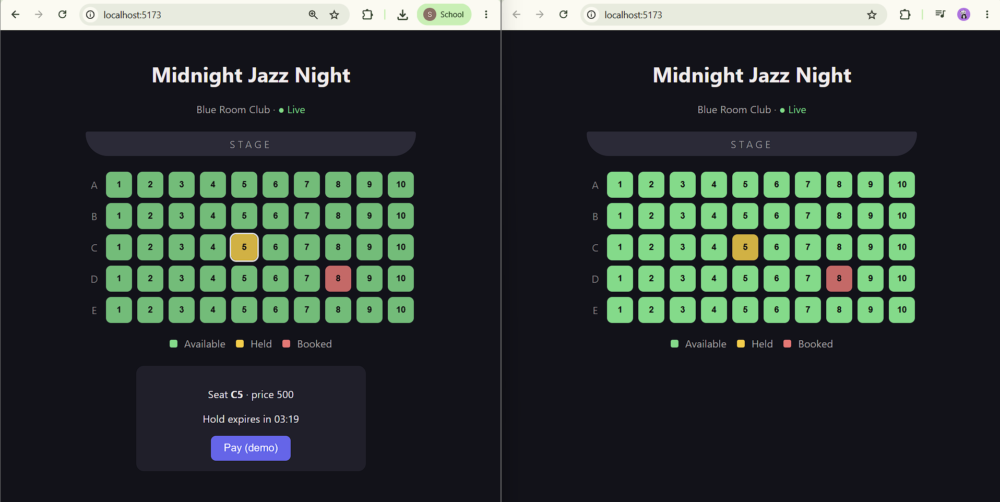

# Real-Time Seat Booking & Ticketing Engine

A full-stack seat booking system (BookMyShow-style) built to solve one hard problem: **many users clicking the same seat at the same moment, with zero double bookings.**

- Seats are **held for 5 minutes** while the user pays, then released automatically.
- Every open browser **updates live** over WebSockets, with no page refresh.
- Concurrency is handled with **PostgreSQL row-level locks**, and proven with a 500-user load test.



## Load test results

500 users try to hold the **same seat at the same instant** (100 threads, released together from a starting gate).

| Setup | Users who got the seat | Rejected | Result |
|---|---|---|---|
| Without lock (`findById`) | **10** | 490 | Double booking |
| With pessimistic lock (`SELECT ... FOR UPDATE`) | **1** | 499 | Correct |

The test is `ConcurrentBookingTest`. It runs against a real PostgreSQL database and calls the service layer directly, so it measures the locking logic rather than HTTP overhead. The number of winners without the lock varies from run to run.

## How it works

```
 React (Vite)  ──REST──►  Spring Boot  ──JPA──►  PostgreSQL
      ▲                       │
      └────── STOMP/WebSocket ┘   (seat updates pushed to every open screen)
```

**Seat lifecycle:** `AVAILABLE` → `HELD` (5 min) → `BOOKED`, or back to `AVAILABLE` if the hold expires.

1. **Hold:** the seat row is locked with `SELECT ... FOR UPDATE` (JPA `PESSIMISTIC_WRITE`). A second request waits for the lock, then sees the seat is already held and gets `409 Conflict`.
2. **Confirm:** takes the same lock and checks `hold_expires_at` at payment time, so a late payment can never confirm an expired hold.
3. **Auto-release:** a scheduled job runs every 10 seconds and frees expired holds.
4. **Live updates:** after each change is committed, the server publishes the seat to `/topic/events/{eventId}/seats`. Updates go out only after the transaction commits, so clients never see a change that wasn't saved.

## Tech stack

| Layer | Tech |
|---|---|
| Backend | Java 17, Spring Boot 4, Spring Data JPA (Hibernate), Spring WebSocket (STOMP), `@Scheduled` |
| Database | PostgreSQL 17, Liquibase migrations |
| Frontend | React, Vite, `@stomp/stompjs` |
| Testing | JUnit 5, `@SpringBootTest` concurrency test |

## API

| Method | Endpoint | Description |
|---|---|---|
| GET | `/api/events` | List events |
| GET | `/api/events/{eventId}/seats` | List seats for an event |
| POST | `/api/seats/{seatId}/hold` | Hold a seat for 5 minutes (`409` if taken) |
| POST | `/api/seats/{seatId}/confirm` | Confirm a held seat (`409` if not held or expired) |

**WebSocket:** connect to `ws://localhost:8080/ws`, subscribe to `/topic/events/{eventId}/seats`.

## Run it locally

**Prerequisites:** Java 17, Node.js, PostgreSQL.

**1. Create the database**

```sql
CREATE DATABASE ticketing;
```

**2. Add your database password.** Create `ticketing/src/main/resources/application-local.properties` (it is git-ignored):

```properties
spring.datasource.password=YOUR_PASSWORD
```

**3. Start the backend** (Liquibase creates the tables and seeds 1 event with 50 seats)

```bash
cd ticketing
./mvnw spring-boot:run        # Windows: mvnw.cmd spring-boot:run
```

**4. Start the frontend**

```bash
cd ticketing-ui
npm install
npm run dev
```

Open the URL Vite prints (usually `http://localhost:5173`). Open it in two windows to see live updates.

**5. Run the concurrency test**

```bash
cd ticketing
./mvnw test -Dtest=ConcurrentBookingTest
```

Expected output: `SUCCESS=1 REJECTED=499 ERRORS=0`.

## Project structure

```
ticketing/       Spring Boot backend
  controller/    REST endpoints
  service/       BookingService (hold, confirm, release)
  repository/    JPA repositories, including the locking query
  scheduler/     HoldExpiryJob
  websocket/     STOMP config and seat event publisher
ticketing-ui/    React seat grid
```

## Limitations and future work

- No user accounts yet, so anyone can hold any seat. Next step: Spring Security with JWT, and tying holds to a user.
- Payment is a demo button. Next step: Stripe test mode.
- The WebSocket broker is in-memory, so it works on a single server. Scaling out needs a broker relay (RabbitMQ) or Redis pub/sub.
- The load test targets the service layer, not the full HTTP stack. A k6 or Gatling test over HTTP would be a good addition.
- CORS and WebSocket origins are open for development. Restrict them before deploying.
